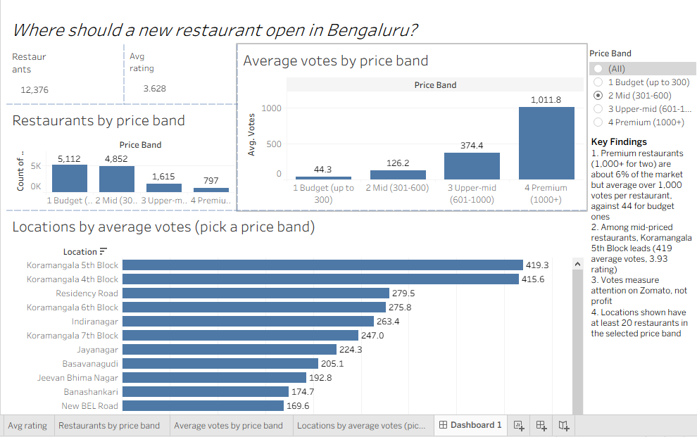

# Zomato Bengaluru Restaurant Analysis: Where Should a New Restaurant Open?

An end-to-end data analysis project (Python, SQL, Tableau) that uses Zomato restaurant listings to answer three questions for someone planning to open a restaurant in Bengaluru:

1. **Where** should it be?
2. **What cuisine** should it serve?
3. **What price range** should it target?



---

## Data

- **Source:** [Zomato Bangalore Restaurants](https://www.kaggle.com/datasets/himanshupoddar/zomato-bangalore-restaurants) on Kaggle (published by himanshupoddar)
- **Raw data:** 51,717 rows and 17 columns of Zomato restaurant listings in Bengaluru
- **After cleaning:** 12,376 unique restaurants and 11 columns

The same restaurant appears several times in the raw data (once per listing category), so the raw row count is not the number of restaurants.

## Tools

| Tool | Used for |
|---|---|
| Python (pandas, matplotlib) in Jupyter | Exploration, cleaning, analysis, quick charts |
| SQLite (DB Browser for SQLite) | Rebuilding the key results with SQL |
| Tableau | Interactive dashboard |

## Project structure

```
zomato-analysis/
├── data/
│   ├── raw/          original CSV, never edited
│   └── clean/        zomato_clean.csv, zomato_dashboard.csv, zomato.db
├── notebooks/
│   ├── 01_exploration.ipynb
│   ├── 02_cleaning.ipynb
│   ├── 03_quick_charts.ipynb
│   └── 04_business_analysis.ipynb
├── sql/              SQL queries (price bands, locations, location x price band)
├── dashboard/        Tableau workbook and chart images
└── README.md
```

---

## Process

### 1. Exploration
Before changing anything, I inspected the shape, data types, missing values, duplicates, and value counts of each column. This produced a list of problems to fix.

### 2. Cleaning decisions

| Problem found | What I did | Why |
|---|---|---|
| 76% of rows repeated the same name and address | Removed duplicates on name + address: 51,717 to 12,499 rows | Otherwise every count and average would be inflated about four times. I used name and address together, so different outlets of the same chain were kept |
| Ratings stored as text (`3.9/5`, `3.9 /5`) | Removed `/5` and spaces, converted to numbers | Text ratings cannot be averaged |
| Hidden missing values: `NEW` and `-` in ratings, `[]` in menu and review columns | Converted `NEW` and `-` to real missing values | They looked like data but were not |
| Cost stored as text with commas (`1,000`) | Removed commas, converted to numbers | Needed for calculations |
| 3,132 restaurants (25%) have no usable rating | **Kept them**, left the rating blank | Dropping them would remove a quarter of the restaurants from questions that do not involve ratings. Averages in pandas, SQL, and Tableau skip blanks automatically. I did not fill them with an average, because that would invent ratings |
| A few rows missing cost, cuisine, location, or type | Dropped 123 rows | Small share, and these columns are central to the questions |
| `dish_liked` (54% missing), `menu_item` (77% empty), `reviews_list` (long text), `url`, `phone`, `listed_type` | Dropped these columns | Too incomplete, not needed for the questions, or unreliable after removing duplicates |

### 3. Analysis approach

The goal was to compare locations, cuisines, and price bands fairly. For each group, I measured four things:

| Measure | How it is calculated | What it stands for | Limitation |
|---|---|---|---|
| **Competition** | Number of restaurants in the group | How crowded that segment already is | More restaurants does not automatically mean a worse place to open; it can also show that a market exists |
| **Demand (proxy)** | Votes per restaurant: the number of customer votes a restaurant has collected on Zomato | How much customer attention each restaurant receives | Votes measure popularity on one platform, not sales or profit. They build up over time, so older restaurants have more |
| **Quality** | Average rating of the restaurants that have one | How satisfied customers are | 25% of restaurants have no rating, so this covers only the rated ones |
| **Price level** | Cost for two, grouped into four bands: Budget (up to 300), Mid (301 to 600), Upper-mid (601 to 1,000), Premium (above 1,000) | The segment a restaurant targets | The band edges are my choice, based on the quartiles of the data (250, 400, 600) |

The dataset has no sales or revenue figures, so votes are used as a stand-in ("proxy") for demand. This is the biggest assumption in the project, and the findings should be read as signs of popularity, not proof of profitability.

**Why medians for votes and cost**

Votes and cost are heavily skewed: a few very popular or very expensive restaurants pull the average far above what a typical restaurant looks like. For example, Indiranagar averages 477 votes per restaurant, but its median is only 73. Across the city, the average cost for two is 487 against a median of 400. So I used medians to describe a "typical" restaurant.

SQLite has no built-in median function, and the Tableau charts use averages, so the SQL queries and the dashboard report averages. I cross-checked them against the pandas medians and flagged cases where the two disagree. For instance, Koramangala 4th Block ranks second among mid-priced locations by average votes (416) but does not make the top 10 by median votes, which means a few very popular restaurants lift its average.

**Minimum group sizes**

A group with only a handful of restaurants can top a ranking by luck (one restaurant with a 4.9 rating, for example). To avoid this, I only compared groups above a minimum size:

| Comparison | Minimum restaurants per group |
|---|---|
| Locations (overall) | 30 |
| Cuisines | 50 |
| Cuisine within a price band | 20 |
| Location within a price band | 15 to 20 |

**Comparing like with like**

Price has a very strong effect on votes: the typical premium restaurant has 442 votes against 8 for a typical budget one. Ranking locations by votes alone would mostly show which locations have more premium restaurants, not which locations are better. So I compared locations within a single price band (mid-priced only, then premium only), which separates the effect of location from the effect of price. I also checked each cuisine's median cost, to see whether a cuisine ranks highly only because it is expensive.

**Handling missing ratings and overlapping cuisines**

- Restaurants without a rating are kept in the counts and vote measures, and excluded only from the rating averages. I did not fill them with an average, because that would create ratings that do not exist.
- Each restaurant lists several cuisines, so I split them and counted the restaurant under each one. Cuisine counts therefore overlap.
### 4. SQL
Key results were rebuilt in SQL (`CASE WHEN`, `GROUP BY`, `HAVING`, `WHERE`) and checked against the pandas results. All of them matched.

### 5. Dashboard
The Tableau dashboard shows the market overview and a location ranking that updates when you pick a price band. It was verified against the SQL results.

---

## Key findings

### The market
- Typical rating is **3.7**, and most restaurants fall between 3.3 and 4.1.
- Typical cost for two is **400**, and most restaurants charge 200 to 600.
- Whitefield (872 restaurants), Electronic City (723), BTM (721), HSR (699), and Marathahalli (676) have the most restaurants.

### Price is the strongest pattern

| Price band | Restaurants | Share | Avg rating | Avg votes | Median votes |
|---|---|---|---|---|---|
| Budget (up to 300) | 5,112 | 41% | 3.54 | 44.3 | 8 |
| Mid (301-600) | 4,852 | 39% | 3.57 | 126.2 | 31 |
| Upper-mid (601-1000) | 1,615 | 13% | 3.71 | 374.4 | 131 |
| Premium (1000+) | 797 | 6% | 4.10 | 1,011.8 | 442 |

Premium restaurants are about 6% of the market but hold about 36% of all votes. Budget restaurants are 41% of the market and hold about 10%.

### Where: crowded is not the same as high demand
- Electronic City (723 restaurants) averages 76 votes per restaurant and BTM (721) averages 95, while Indiranagar (526) averages 477.
- The highest attention per restaurant is in small central locations: Church Street (847 votes, 57 restaurants), Lavelle Road (769, 56), and St. Marks Road (624, 34), plus Koramangala 5th Block (666, 265 restaurants).
- Averages are lifted by a few very popular restaurants. Medians are lower (Church Street 202, Lavelle Road 319.5, Koramangala 5th Block 122, Indiranagar 73), so Indiranagar looks weaker than its average suggests.

### Where, with price held constant
- **Mid-priced:** Koramangala 5th Block leads with 419 average votes and a 3.93 rating across 90 restaurants. Its median is 155.5 votes, against 31 for mid-priced restaurants citywide. Koramangala 4th Block (416) is close on average, but a typical restaurant there gets far less attention.
- **Premium:** Koramangala 5th Block again, with a median of 1,774 votes and a 4.34 rating across 31 restaurants, ahead of Indiranagar (1,071 median votes, 78 restaurants).
- Location matters on its own, not only through price.

### What cuisine
- The highest-rated cuisines are Mediterranean (4.20), European (4.16), Asian (4.09), and Steak (4.04), but they are also the most expensive (median cost 1,000 to 1,500), so their ratings largely reflect premium dining.
- **Italian** leads within both Premium (median 662 votes, 145 restaurants) and Upper-mid (median 285 votes, 158 restaurants).
- **Premium Pizza** has fewer competitors (58 restaurants) and a 4.25 rating. Pizza and Italian overlap, because a restaurant can be listed under both.
- Premium North Indian (405 restaurants) and Continental (342) are the most crowded premium cuisines.

### Candidate options (hypotheses, not proof)

| Option | Evidence | Caveat |
|---|---|---|
| Premium restaurant in Koramangala 5th Block | Median 1,774 votes, 4.34 rating, 31 competitors | Rent and running costs are not in the data |
| Premium Italian or Pizza concept | Italian: median 662 votes. Pizza: 4.25 rating, 58 restaurants | The two overlap, and cuisine plus location groups were too small to test |
| Mid-priced restaurant in Koramangala 5th Block or Jayanagar | Mid-priced median of 155.5 votes in the 5th Block vs 31 citywide | Lower attention than premium, but cheaper to start |

---

## Limitations

- **Votes measure popularity on Zomato, not revenue or profit.** Premium diners may simply review more, and older restaurants have had longer to collect votes.
- **Costs are missing:** rent, staff, and ingredients are not in the data, so the analysis cannot say whether the extra attention at premium restaurants pays for the higher cost.
- **Association is not causation:** charging more would not automatically bring more votes.
- **25% of restaurants have no rating,** so rating comparisons cover only the rated ones.
- **Cuisine counts overlap,** because a restaurant serving several cuisines counts under each.
- **Some groups are small** (15 to 40 restaurants), so small gaps between them should not be over-read.
- **Snapshot data:** it shows one point in time, not trends.

## Future work

- Sentiment analysis of the review text to see what customers praise or complain about in each location and cuisine
- Online ordering, table booking, and restaurant type (cafe, casual dining, quick bites) as additional factors
- Chain versus independent restaurants
- Adding rent or cost data, to move from popularity toward profitability

---

## How to reproduce

1. Install the libraries: `pip install pandas matplotlib`
2. Put the raw CSV in `data/raw/`
3. Run the notebooks in order (`01` to `04`). `02_cleaning.ipynb` creates `data/clean/zomato_clean.csv`
4. Open `data/clean/zomato.db` in DB Browser for SQLite and run the queries in `sql/`
5. Open the Tableau workbook in `dashboard/`

## Author

Usha Sanghamitra

[LinkedIn](https://www.linkedin.com/in/ushasanghamitra-siddani-37a076417/) | [GitHub](https://github.com/ushasanghamitrasiddani)
